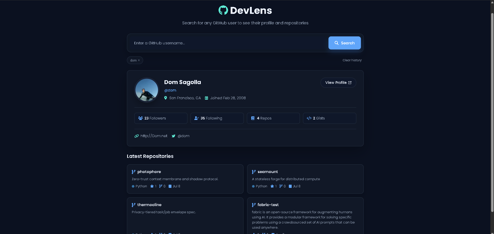
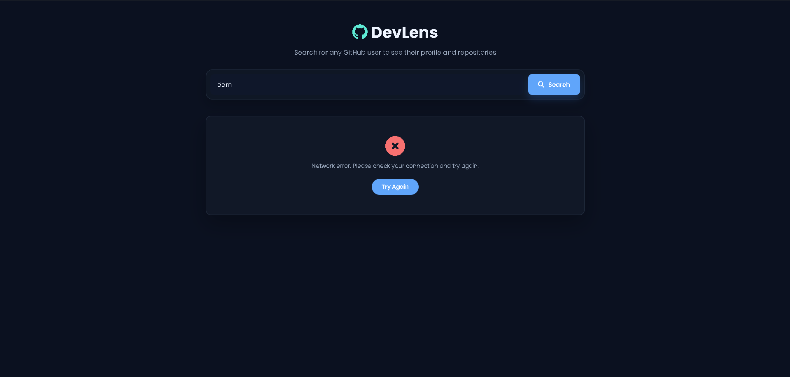
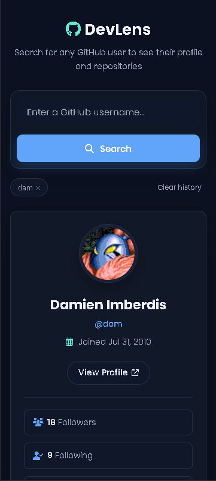
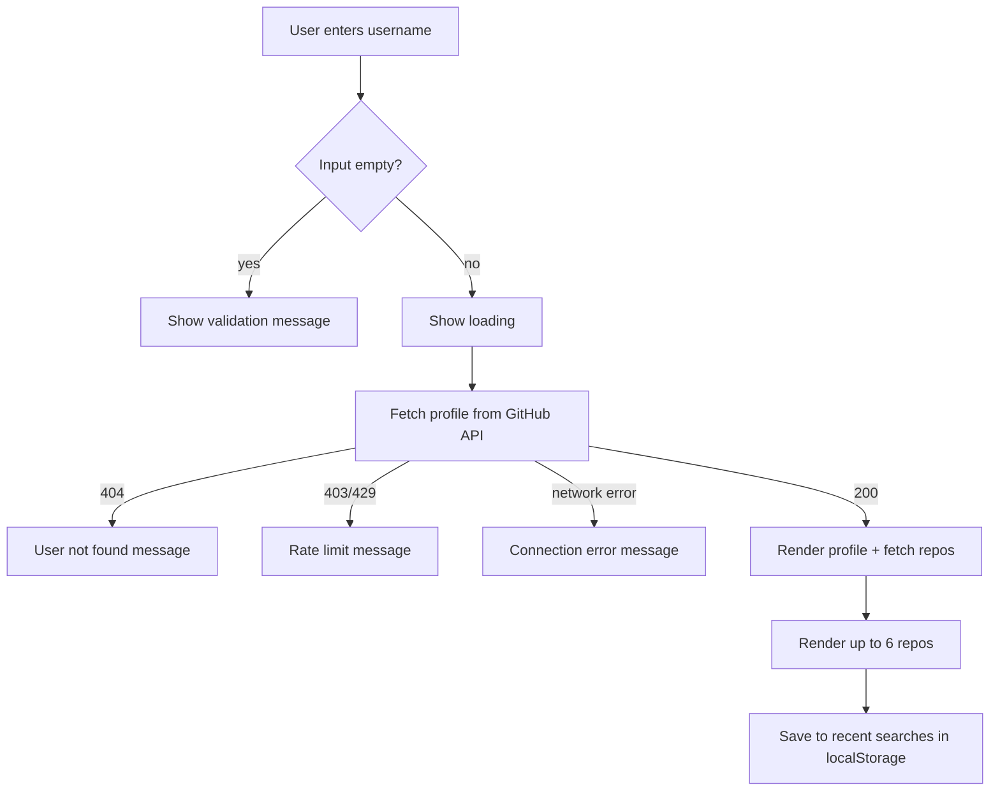

# DevLens

A beginner-friendly GitHub profile viewer built with HTML, CSS, and vanilla JavaScript.

**[Live Demo](https://sakshamzalpuri.github.io/DevLens/) · [Source Code](https://github.com/sakshamzalpuri/DevLens)**

## Features

- Search for a GitHub username by clicking Search or pressing Enter.
- View avatar, name, username, bio, followers, following, and public repo count.
- Browse up to six repositories with names, descriptions, and star counts.
- Revisit up to three recent searches from a clickable history list.
- Loading text and clear error messages.
- Responsive layout for desktop and mobile.

## Screenshots

| Profile result | Error state | Mobile |
|---|---|---|
|  |  |  |

## Application Flow

1. User types a username and clicks **Search** or presses **Enter**.
2. Input is trimmed and validated. Empty input shows a message and no request is sent.
3. "Loading..." is shown while the app calls `https://api.github.com/users/{username}`.
4. On success, the profile card renders, then the repos are fetched from `/users/{username}/repos` and the first six are displayed.
5. The username is saved to `localStorage` (max 3, newest first, no duplicates) and the history list updates.
6. Clicking a history item re-runs the search with that username.



## Error Handling

| Scenario | What the user sees |
|---|---|
| Empty input | Prompt to enter a username, no API call |
| User doesn't exist (404) | "User not found" message, previous result cleared |
| Rate limit hit (403/429) | Message that the GitHub API limit was reached, try again later |
| Network failure / offline | Connection error message |
| User has no repos | Empty repos message instead of a blank section |
| Missing bio/name | Fallback text instead of `null` |

## Tech Stack

HTML5, CSS3, Vanilla JavaScript, GitHub REST API, localStorage

## Run Locally

No package installation or build step is required.

```bash
git clone https://github.com/sakshamzalpuri/DevLens.git
cd DevLens
```

Open `index.html` in your browser, or use the VS Code Live Server extension.

## API Notes

DevLens uses GitHub's public REST API. Unauthenticated requests are limited to 60/hour per IP, so searches may temporarily fail when the limit is reached.

